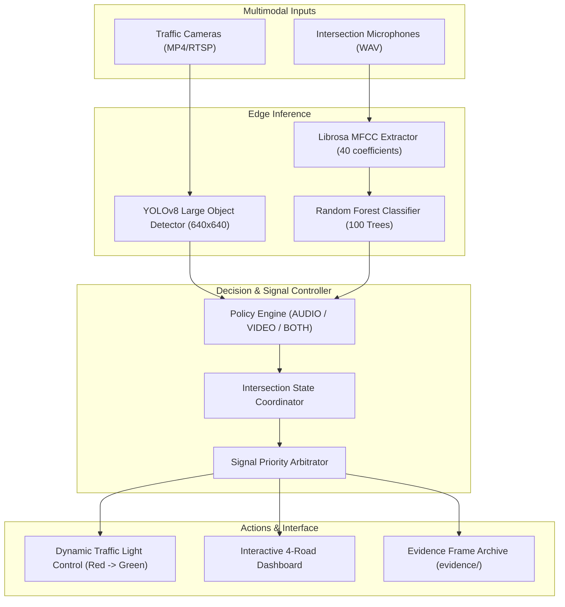

# AI Ambulance Detection & Traffic Signal Priority System

[](https://www.python.org/)
[](https://docs.ultralytics.com/)
[](https://opencv.org/)
[](https://librosa.org/)
[-brightgreen.svg)]()
[](https://creativecommons.org/licenses/by/4.0/)

An end-to-end edge AI system that combines **deep learning computer vision (YOLOv8 Large)** and **acoustic machine learning (MFCC + Random Forest)** to dynamically prioritize traffic signals at urban intersections for approaching emergency ambulances.

---

## 📌 Problem Statement

Emergency vehicles in developing urban areas frequently experience severe traffic congestion, leading to delayed patient hospital arrival times. Traditional traffic lights follow rigid fixed-time schedules or simple induction loops that cannot distinguish emergency vehicles from general commuter traffic. 

This project solves that challenge by implementing a multimodal edge AI solution that:
1. **Visually identifies ambulances** from CCTV/traffic camera video feeds in real time.
2. **Acoustically identifies sirens** using audio frequency feature analysis to detect approaching ambulances even before they enter the camera's field of view or when obscured by large vehicles.
3. **Coordinates a 4-way intersection signal controller** to dynamically grant immediate green-light passage to the approach with the emergency vehicle while holding other lanes at red.

---

## 🚀 Key Features

- **YOLOv8 Large Deep Learning Model:** Fine-tuned for ambulance detection, early-stopped after 187 epochs (200 configured), achieving **87.39% Precision** and **74.23% mAP@50** at the best epoch.
- **Acoustic Siren Classifier:** Extracts 40-dimensional Mel-Frequency Cepstral Coefficients (MFCC) processed through an optimized Random Forest classifier to distinguish sirens from ambient city and engine noises.
- **Multimodal Decision Policies:** Configurable per approach:
  - `AUDIO`: Triggers priority green signal upon acoustic siren confirmation.
  - `VIDEO`: Triggers priority green signal upon visual bounding box detection above threshold ($\ge 0.65$).
  - `BOTH`: Strict dual-confirmation mode requiring both audio and video verification to eliminate false positives.
- **Interactive 4-Approach Dashboard:** Full-featured desktop GUI (Tkinter + OpenCV) visualizing 4 simultaneous road feeds, traffic signal states, detection logs, and manual overrides.
- **Evidence Capture (single-stream pipeline):** `ambulance_and_siren_integration.py` writes timestamped snapshots to `evidence/` when visual and audio detections are both confirmed. The 4-road dashboard holds the priority green state until **Clear All** is pressed.
- **Fully Automated Pytest Suite:** 16 comprehensive unit and integration tests covering vision, audio, and state machine priority logic.

---

## 🏗️ System Architecture



---

## 📊 Model Performance & Benchmarks

### 1. Vision Model (`yolov8l_ambulance.pt`)
*Best-epoch validation metrics read directly from the checkpoint's embedded `train_metrics` dictionary. No `results.csv`, `best.pt`, or `last.pt` training artefacts are retained in this repository.*

| Metric | Measured Value | Percentage |
| :--- | :--- | :--- |
| **Architecture** | YOLOv8 Large (`yolov8l.pt`) | — |
| **Precision (B)** | `0.87388` | **87.39%** |
| **Recall (B)** | `0.69374` | **69.37%** |
| **mAP@50 (B)** | `0.74229` | **74.23%** |
| **mAP@50-95 (B)** | `0.40584` | **40.58%** |
| **Epochs Trained** | 187 (patience=100) | — |
| **Validation Box Loss** | `1.66486` | — |
| **Validation Class Loss** | `1.46766` | — |

### 2. Audio Classifier (`siren_classifier.pkl`)
- **Classifier:** Scikit-learn `RandomForestClassifier(random_state=42)`
- **Acoustic Features:** 40 Mel-Frequency Cepstral Coefficients (MFCC), 3.0s window, 22.05 kHz sampling rate
- **Classes:** Binary (`0`: Non-Siren / Traffic Noise, `1`: Emergency Siren)
- **Dataset Balance:** 200 siren recordings + 200 non-siren recordings (400 total WAV files)

---

## 📂 Repository Structure

```
ambulance-detection-project/
├── new.py                              # Main Application: 4-Way Intersection Dashboard
├── ambulance_and_siren_integration.py  # Single-stream dual-modality pipeline
├── ambulance_test.py                  # Standalone YOLOv8 camera inference test
├── test_siren.py                      # Standalone MFCC audio classification test
├── yolov8l_ambulance.pt               # Fine-tuned YOLOv8 Large weights (Git LFS, 83.6 MiB)
├── siren_classifier.pkl               # Trained Random Forest siren classifier
├── requirements.txt                   # Dependency specifications
├── pytest.ini                         # Pytest configuration
├── .gitignore                         # Configured repository ignores
├── LICENSE                            # MIT License
│
├── tests/                             # Automated test suite (16 tests, 100% pass)
│   ├── test_yolo_detection.py
│   ├── test_audio_classification.py
│   └── test_traffic_signal_logic.py
│
├── docs/                              # Comprehensive documentation
│   ├── architecture.md
│   ├── model_evaluation.md
│   ├── dataset_report.md
│   └── testing_report.md
│
└── data/
    ├── ambulance_images/              # 117 Roboflow YOLOv8 annotated images (published in full)
    ├── audio/                         # 2 test fixtures published (full 400-clip set kept locally)
    └── Video/                         # 1 sample clip published (13 clips kept locally)
```

> **Not published (retained locally):** the remaining 398 audio WAVs, 400 generated spectrogram PNGs, 12 additional video clips, and the secondary checkpoint `Yovov8l_Amubalce_trained.pt`. They are excluded by `.gitignore`; see `docs/dataset_report.md` for the full local dataset specification.

---

## ⚙️ Installation & Setup

### Prerequisites
- Python 3.10 – 3.12 (Tested on Python 3.12.5)
- Git

### 1. Clone the Repository
```bash
git clone https://github.com/harshaba0408-netizen/ambulance-detection-project.git
cd ambulance-detection-project
```

### 2. Create and Activate Virtual Environment
```bash
# Windows
python -m venv venv
.\venv\Scripts\activate

# Linux / macOS
python3 -m venv venv
source venv/bin/activate
```

### 3. Install Dependencies
```bash
pip install -r requirements.txt
```

### 4. Fetch Model Weights (Git LFS)
`yolov8l_ambulance.pt` is stored with Git LFS. A normal `git clone` fetches it automatically if Git LFS is installed; otherwise run:
```bash
git lfs install
git lfs pull
```
If LFS is unavailable, download or retrain the weights and place the file in the repository root as `yolov8l_ambulance.pt`. The training configuration is documented in `docs/model_evaluation.md`; the original `results.csv` / `best.pt` / `last.pt` artefacts are not retained.

The secondary checkpoint `Yovov8l_Amubalce_trained.pt` is **not published** (it is an unused comparison model kept only locally). The application loads only `yolov8l_ambulance.pt`.

---

## 🚦 Execution

### 1. Run the Interactive 4-Way Intersection Dashboard
```bash
python new.py
```
- Click **Select Video** to attach traffic footage to any of the 4 roads (e.g. from `data/Video/`).
- Click **Select Audio** to attach an audio stream (e.g. from `data/audio/siren/` or `data/audio/non-siren/`).
- Select the detection policy from the dropdown (**AUDIO**, **VIDEO**, or **BOTH**).
- Observe the real-time bounding box detections and automated Red/Green traffic signal transitions.

### 2. Run the Single-Stream Dual Pipeline
```bash
python ambulance_and_siren_integration.py
```

### 3. Run Standalone Tests
```bash
# Test visual YOLOv8 detection
python ambulance_test.py

# Test acoustic siren classification
python test_siren.py
```

---

## 🧪 Automated Testing

The project includes an automated test suite verifying model loading, inference correctness, acoustic feature extraction, and signal coordination.

Run the test suite with:
```bash
pytest -v
```

Expected Output:
```
============================= test session starts =============================
collected 16 items

tests/test_audio_classification.py::test_siren_classifier_exists PASSED  [  6%]
tests/test_audio_classification.py::test_siren_classifier_loading PASSED [ 12%]
tests/test_audio_classification.py::test_mfcc_feature_extraction_dimension PASSED [ 18%]
tests/test_audio_classification.py::test_siren_classification_prediction PASSED [ 25%]
tests/test_audio_classification.py::test_invalid_audio_path_handling PASSED [ 31%]
tests/test_traffic_signal_logic.py::test_default_all_red PASSED          [ 37%]
tests/test_traffic_signal_logic.py::test_audio_policy_triggers_green PASSED [ 43%]
tests/test_traffic_signal_logic.py::test_video_policy_triggers_green PASSED [ 50%]
tests/test_traffic_signal_logic.py::test_both_policy_requires_audio_and_video PASSED [ 56%]
tests/test_traffic_signal_logic.py::test_revert_to_red_on_exit PASSED    [ 62%]
tests/test_traffic_signal_logic.py::test_clear_all_resets_all_signals PASSED [ 68%]
tests/test_yolo_detection.py::test_yolo_model_file_exists PASSED         [ 75%]
tests/test_yolo_detection.py::test_yolo_model_loading PASSED             [ 81%]
tests/test_yolo_detection.py::test_yolo_inference_on_synthetic_frame PASSED [ 87%]
tests/test_yolo_detection.py::test_yolo_inference_on_real_ambulance_image PASSED [ 93%]
tests/test_yolo_detection.py::test_yolo_invalid_model_path PASSED        [100%]

======================= 16 passed, 1 warning in 26.89s ========================
```

*Two consecutive runs on 2026-11-09 with Python 3.12.5 on CPU-only Windows: **68.73 s** (cold filesystem cache) and **26.89 s** (warm cache). Runtime varies by machine. These are automated unit/integration tests — no hardware-in-the-loop or live traffic-camera testing was performed.*

---

## ⚠️ Limitations & Future Enhancements

- **Hardware Deployment:** Currently simulated via a software GUI. Future work can interface directly with physical microcontrollers (e.g., Arduino / Raspberry Pi / ESP32) using GPIO pins or RS-485 serial relays.
- **Directional Audio Sensing:** The current audio pipeline detects siren presence but does not compute Angle-of-Arrival (AoA). Integrating a microphone array with Generalized Cross-Correlation (GCC-PHAT) would enable directional acoustic localization.
- **Occlusion Handling:** Heavy multi-vehicle occlusions can be mitigated by combining aerial or multi-camera fusion at larger intersections.

---

## 📄 License

- Source code licensed under the [MIT License](LICENSE).
- Dataset annotations adapted from Roboflow Universe under [CC BY 4.0](https://creativecommons.org/licenses/by/4.0/).

---

## 👤 Author

**Harsha B A**
- GitHub: [@harshaba0408-netizen](https://github.com/harshaba0408-netizen)
- Repository: [ambulance-detection-project](https://github.com/harshaba0408-netizen/ambulance-detection-project)

