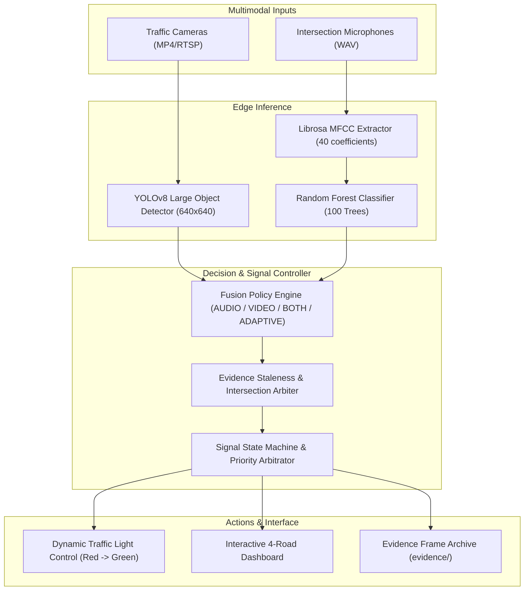

# AI Ambulance Detection & Traffic Signal Priority System

[](https://www.python.org/)
[](https://docs.ultralytics.com/)
[](https://opencv.org/)
[](https://librosa.org/)
[-brightgreen.svg)]()
[](https://creativecommons.org/licenses/by/4.0/)

An end-to-end edge AI system that combines **deep learning computer vision (YOLOv8 Large)** and **acoustic machine learning (MFCC + Random Forest)** to dynamically prioritize traffic signals at urban intersections for approaching emergency ambulances.

---

## 📌 Problem Statement

Emergency vehicles in developing urban areas frequently experience severe traffic congestion, leading to delayed patient hospital arrival times. Traditional traffic lights follow rigid fixed-time schedules or simple induction loops that cannot distinguish emergency vehicles from general commuter traffic. 

This project solves that challenge by implementing a multimodal edge AI solution that:
1. **Visually identifies ambulances** from CCTV/traffic camera video feeds in real time.
2. **Acoustically identifies sirens** using audio frequency feature analysis to detect approaching ambulances even before they enter the camera's field of view or when obscured by large vehicles.
3. **Coordinates a 4-way intersection signal controller** to dynamically grant immediate green-light passage to the approach with the emergency vehicle while holding other lanes at red.

---

## 🚀 Key Features

- **YOLOv8 Large Deep Learning Model:** Fine-tuned for ambulance detection, early-stopped after 187 epochs (200 configured), achieving **87.39% Precision** and **74.23% mAP@50** at the best epoch.
- **Acoustic Siren Classifier:** Extracts 40-dimensional Mel-Frequency Cepstral Coefficients (MFCC) processed through an optimized Random Forest classifier to distinguish sirens from ambient city and engine noises.
- **Multimodal Decision Policies:** Configurable per approach:
  - `AUDIO`: Triggers priority green signal upon acoustic siren confirmation.
  - `VIDEO`: Triggers priority green signal upon visual bounding box detection above threshold ($\ge 0.65$).
  - `BOTH`: Strict dual-confirmation mode requiring fresh audio and video evidence to reduce false positives.
  - `ADAPTIVE`: `BOTH` plus a tighter time window; never looser than `BOTH`.
- **Interactive 4-Approach Dashboard:** Full-featured desktop GUI (Tkinter + OpenCV) visualizing 4 simultaneous road feeds, live preview with bounding boxes, audio/video confidence, fused state, signal phase, FPS/latency, system health, timestamped event history, and manual start/stop/fault controls.
- **Evidence Capture (single-stream pipeline):** `ambulance_and_siren_integration.py` writes timestamped snapshots to `evidence/` when visual and audio detections are both confirmed. In the 4-road dashboard, priority is released by fusion staleness and signal hysteresis; **Clear All** remains a manual full reset.
- **Fully Automated Pytest Suite:** 388 unit and integration tests covering vision, audio, video pipeline, fusion, signal state machine, configuration, logging, metrics, benchmark helpers, audio provenance tooling, and the dashboard view-model, widgets and application shell.
- **Traceable Benchmark Harness:** Three CLI scripts store timestamped JSON results with environment, model hashes, commands and configuration. They report measured vision, audio and software decision-path numbers without claiming retraining or real-world traffic benefit; see [`docs/BASELINE_VS_IMPROVED.md`](docs/BASELINE_VS_IMPROVED.md).

---

## 🏗️ System Architecture



---

## 📊 Model Performance & Benchmarks

### 1. Vision Model (`yolov8l_ambulance.pt`)
*Best-epoch validation metrics read directly from the checkpoint's embedded `train_metrics` dictionary. No `results.csv`, `best.pt`, or `last.pt` training artefacts are retained in this repository.*

| Metric | Measured Value | Percentage |
| :--- | :--- | :--- |
| **Architecture** | YOLOv8 Large (`yolov8l.pt`) | — |
| **Precision (B)** | `0.87388` | **87.39%** |
| **Recall (B)** | `0.69374` | **69.37%** |
| **mAP@50 (B)** | `0.74229` | **74.23%** |
| **mAP@50-95 (B)** | `0.40584` | **40.58%** |
| **Epochs Trained** | 187 (patience=100) | — |
| **Validation Box Loss** | `1.66486` | — |
| **Validation Class Loss** | `1.46766` | — |

### 2. Audio Classifier (`siren_classifier.pkl`)
- **Classifier:** Scikit-learn `RandomForestClassifier(random_state=42)`
- **Acoustic Features:** 40 Mel-Frequency Cepstral Coefficients (MFCC), 3.0s window, 22.05 kHz sampling rate
- **Classes:** Binary (`0`: Non-Siren / Traffic Noise, `1`: Emergency Siren)
- **Dataset Balance:** 200 siren recordings + 200 non-siren recordings (400 total WAV files)
- **Provenance (Stage 11–12):** unverified. No source, session or licence metadata exists beyond an ffmpeg encoder tag. The audit found four exact duplicate siren pairs; the split retains 396 files and excludes them. Stage 12 groups those files into 234 acoustic content groups (60 non-siren, 174 siren) and keeps every group inside one split. The result is **content-group-held-out**, not source-independent. See [`docs/AUDIO_DATASET_PROVENANCE.md`](docs/AUDIO_DATASET_PROVENANCE.md).

### 3. Stage 10 Measured Benchmarks

| Harness | Measurement | Result |
|---|---|---|
| Vision (5-image test split, `conf=0.001`) | Precision / recall / mAP@50 / mAP@50-95 | 0.9207 / 0.4000 / 0.5217 / 0.4088 |
| Vision speed (CPU) | Pipeline per image | 2632.54 ms (0.3799 images/s) |
| Audio (400 training clips) | Resubstitution accuracy / precision / recall / F1 / FPR | 1.0000 / 1.0000 / 1.0000 / 1.0000 / 0.0000 |
| Audio latency | End-to-end median / p95 | 173.21 ms / 246.86 ms |
| System decision path | Median `tick()` wall latency | 0.0972 ms |
| System simulation | Activation delay / clearance | 2.0 s / 5.0 s (simulated time) |

These are not model-improvement claims: the checkpoints were not retrained. Audio scores are resubstitution, and system timings exclude camera and model inference. Commands, stored JSON files and full caveats are in [`docs/BASELINE_VS_IMPROVED.md`](docs/BASELINE_VS_IMPROVED.md).

---

## 📂 Repository Structure

```
ambulance-detection-project/
├── new.py                              # Launch command: 4-way intersection dashboard
├── ambulance_and_siren_integration.py  # Single-stream dual-modality pipeline
├── ambulance_test.py                  # Standalone YOLOv8 camera inference test
├── test_siren.py                      # Standalone MFCC audio classification test
├── yolov8l_ambulance.pt               # Fine-tuned YOLOv8 Large weights (Git LFS, 83.6 MiB)
├── siren_classifier.pkl               # Trained Random Forest siren classifier
├── requirements.txt                   # Dependency specifications
├── requirements-dev.txt               # Test/coverage tooling (pytest-cov)
├── pytest.ini                         # Pytest configuration
├── .gitignore                         # Configured repository ignores
├── LICENSE                            # MIT License
│
├── config/
│   └── default.yaml                   # Validated runtime configuration
│
├── src/ambulance_system/              # Refactored, import-safe application package
│   ├── config.py, events.py, clock.py, logging_utils.py
│   ├── detection/                     # YOLO wrapper and detection types
│   ├── video/                         # File / webcam / RTSP sources + pipeline
│   ├── audio/                         # MFCC features, classifier, streaming
│   ├── fusion/                        # Multimodal evidence policies
│   ├── traffic_signal/                # State machine and cross-approach arbiter
│   ├── monitoring/                    # FPS, latency and resource metrics
│   └── dashboard/                     # View-model, Tk widgets, application shell
│
├── scripts/                           # Evaluation and benchmark harnesses
│   ├── evaluate_yolo.py               # YOLO validation on a named split
│   ├── benchmark_vision.py            # Vision quality + validation-loop speed
│   ├── benchmark_audio.py             # Siren classifier (resubstitution) + latency
│   ├── benchmark_system.py            # Dashboard decision path with FakeClock
│   ├── audio_integrity.py             # Read-only audio audit + opt-in quarantine
│   ├── make_audio_split.py            # Deterministic leakage-aware audio split
│   ├── train_audio.py                 # Experiment-only classifier training
│   └── benchmark_common.py            # Shared formatting and provenance helpers
├── benchmarks/                        # Stored measurement results
│   └── results/                       # Timestamped JSON, traceable to a command
│
├── tests/                             # Automated test suite (398 tests)
│   ├── test_yolo_detection.py         # Legacy vision tests
│   ├── test_audio_classification.py   # Legacy audio tests
│   ├── test_traffic_signal_logic.py   # Legacy coordinator tests
│   ├── test_viewmodel.py              # Headless dashboard tests
│   └── ...                            # Config, events, clock, detector, video,
│                                      # audio streaming, fusion, signal, metrics
│
├── docs/                              # Comprehensive documentation
│   ├── architecture.md
│   ├── dashboard.md
│   ├── fusion.md
│   ├── configuration.md
│   ├── model_evaluation.md
│   ├── dataset_report.md
│   ├── testing_report.md
│   ├── AUDIO_DATASET_PROVENANCE.md
│   ├── BASELINE_VS_IMPROVED.md
│   └── ...
│
└── data/
    ├── ambulance_images/              # 117 Roboflow YOLOv8 annotated images (published in full)
    ├── audio/                         # 2 test fixtures published (full 400-clip set kept locally)
    └── Video/                         # 1 sample clip published (13 clips kept locally)
```

> **Not published (retained locally):** the remaining 398 audio WAVs, 400 generated spectrogram PNGs, 12 additional video clips, and the secondary checkpoint `Yovov8l_Amubalce_trained.pt`. They are excluded by `.gitignore`; see `docs/dataset_report.md` for the full local dataset specification.

---

## ⚙️ Installation & Setup

### Prerequisites
- Python 3.10 – 3.12 (Tested on Python 3.12.5)
- Git

### 1. Clone the Repository
```bash
git clone https://github.com/harshaba0408-netizen/ambulance-detection-project.git
cd ambulance-detection-project
```

### 2. Create and Activate Virtual Environment
```bash
# Windows
python -m venv venv
.\venv\Scripts\activate

# Linux / macOS
python3 -m venv venv
source venv/bin/activate
```

### 3. Install Dependencies
```bash
pip install -r requirements.txt
```

### 4. Fetch Model Weights (Git LFS)
`yolov8l_ambulance.pt` is stored with Git LFS. A normal `git clone` fetches it automatically if Git LFS is installed; otherwise run:
```bash
git lfs install
git lfs pull
```
If LFS is unavailable, download or retrain the weights and place the file in the repository root as `yolov8l_ambulance.pt`. The training configuration is documented in `docs/model_evaluation.md`; the original `results.csv` / `best.pt` / `last.pt` artefacts are not retained.

The secondary checkpoint `Yovov8l_Amubalce_trained.pt` is **not published** (it is an unused comparison model kept only locally). The application loads only `yolov8l_ambulance.pt`.

---

## 🚦 Execution

### 1. Run the Interactive 4-Way Intersection Dashboard
```bash
python new.py
```
- Click **Select Video** to attach traffic footage to any of the 4 approaches (e.g. from `data/Video/`).
- Click **Select Audio** to attach an audio stream (e.g. from `data/audio/siren/` or `data/audio/non-siren/`).
- Pick a detection policy **per approach** from each card's dropdown: **AUDIO**, **VIDEO**, **BOTH**, or **ADAPTIVE**.
- Press **Start** on a card (selecting a file also starts the sources that policy needs) and **Stop** to release that approach's workers.
- Observe the live preview, bounding box, audio/video confidence, fused state and reason, signal head, FPS/latency, system health, and timestamped event history.
- Use **Clear All** for a full manual reset (stops sources, clears evidence and previews, returns all signals to red, restores the default policy). **Simulate Fault** and **Clear Fault** exercise the all-red fault path.

The dashboard is a software simulation and the YOLOv8-L model runs on CPU, so preview frame rate depends on the machine. The UI is split into a headless view-model, render-only widgets, and a Tk application shell; see [`docs/dashboard.md`](docs/dashboard.md).

### 2. Run the Single-Stream Dual Pipeline
```bash
python ambulance_and_siren_integration.py
```

### 3. Run Standalone Tests
```bash
# Test visual YOLOv8 detection
python ambulance_test.py

# Test acoustic siren classification
python test_siren.py
```

---

## 🧪 Automated Testing

The project includes **398 automated unit and integration tests** covering configuration, events, clock, logging, YOLO detection, video sources and pipeline metrics, audio features/classifier/streaming, multimodal fusion, the signal state machine and arbiter, benchmark helpers, audio provenance tooling, and the dashboard view-model, widgets and application shell.

Run the suite with:
```powershell
.\venv\Scripts\python.exe -m pytest -q
```

Full run on 2026-11-11 (Python 3.12.5, CPU-only Windows):
```
398 passed, 1 warning in 42.38s
```
The last coverage rerun (388-test suite) took 50.23 s. Earlier runs on 2026-11-10 took 59.48–103.55 s for the then-current 367 tests; the pass count was unchanged within each run. Times vary with machine load.

The single warning is the existing Librosa `audioread` deprecation notice triggered by the legacy invalid-path test; no test is skipped on a machine with a display and no assertion is weakened. The 16 legacy tests remain in `tests/test_yolo_detection.py`, `tests/test_audio_classification.py`, and `tests/test_traffic_signal_logic.py`.

### Coverage

Install the development-only tooling and run the same suite with coverage:

```powershell
.\venv\Scripts\python.exe -m pip install -r requirements-dev.txt
.\venv\Scripts\python.exe -m pytest -q --cov=src/ambulance_system --cov-report=term-missing
```

Measured result on 2026-11-11 (388-test suite): **388 passed, 1 warning, 92% statement coverage** (`221` missed statements out of `2778`). The Stage 12 tests add 10 provenance checks; they do not change these source-coverage figures. Selected module results:

| Module | Coverage |
|---|---:|
| `dashboard/widgets.py` | 100% |
| `dashboard/viewmodel.py` | 97% |
| `dashboard/app.py` | 68% |
| `traffic_signal/states.py` | 97% |
| `events.py` | 100% |
| `config.py` | 96% |
| `fusion/engine.py` | 97% |

The lower `app.py` figure is honest: model loading, file dialogs, real video/audio worker threads and `main()` are not exercised by unit tests. The rendering widgets are tested with a hidden Tk window; those tests skip with a clear reason on a machine without a display. Coverage measures executed statements only, not traffic-control correctness.

The dashboard logic is tested through `DashboardViewModel` without a display, model checkpoint or video file. A manual UI smoke test (withdrawn Tk root, fake detector/classifier, `app.on_close`) is also run outside the automated suite. *These are software tests on one machine; no hardware-in-the-loop or live traffic-camera validation was performed.*

### Benchmarks

Three CLI harnesses store timestamped JSON under `benchmarks/results/`. Each file records the environment, command, configuration and model hash (where applicable), so a number can be traced and rerun.

```powershell
# Vision quality + validation-loop speed (5-image test split, conf=0.001)
.\venv\Scripts\python.exe scripts\benchmark_vision.py --split test --imgsz 640 --no-plots

# All 400 local audio clips; resubstitution, not held-out validation
.\venv\Scripts\python.exe scripts\benchmark_audio.py

# Synthetic evidence through DashboardViewModel + FakeClock; no model inference
.\venv\Scripts\python.exe scripts\benchmark_system.py
```

Measured on this CPU (2026-11-10):

| Harness | Stored result | Headline measurement |
|---|---|---|
| Vision | `vision_test_640_20261110T084458Z.json` | precision 0.9207, recall 0.4000, mAP@50 0.5217, mAP@50-95 0.4088; 2632.54 ms/image pipeline (0.3799 images/s) |
| Audio | `audio_resubstitution_20261110T083904Z.json` | resubstitution accuracy / precision / recall / F1 1.0000, FPR 0.0000; 173.21 ms median end-to-end |
| System | `system_simulation_20261110T085500Z.json` | 0.0972 ms median `tick()`; 2.0 s simulated activation delay; 5.0 s simulated clearance |

These are **not** model-improvement or real-world traffic claims. The shipped vision checkpoint and shipped audio classifier were not retrained; the audio scores above are training-data fit; system timings exclude inference. Stage 11 adds a separate experiment-only classifier, reported below. Full provenance, baseline comparison and limitations are in [`docs/BASELINE_VS_IMPROVED.md`](docs/BASELINE_VS_IMPROVED.md).

### Audio Provenance (Stage 11–12)

```powershell
# Read-only audit: hashes, formats, encoder tags, duplicate groups
.\venv\Scripts\python.exe scripts\audio_integrity.py

# Read-only acoustic content groups (writes CSV + optional JSON summary)
.\venv\Scripts\python.exe scripts\audio_content_groups.py

# Content-group-aware split; no group spans two splits
.\venv\Scripts\python.exe scripts\make_audio_split.py --manifest data\audio\content_groups.csv --seed stage12-20261111

# Experiment-only Random Forest; the shipped classifier is never overwritten
.\venv\Scripts\python.exe scripts\train_audio.py --split data\audio\splits\audio_split.json
```

| Result | Stored file |
|---|---|
| 400 files, 4 exact duplicate siren pairs, 18 encoding cohorts | `benchmarks/results/audio_integrity_20261111T071208Z.json` |
| 234 acoustic content groups: 60 non-siren + 174 siren; 0 groups span splits | `benchmarks/results/audio_content_groups_20261111.json` |
| 396-file content-group split, 280 / 62 / 54; seed `stage12-20261111` | `data/audio/splits/audio_split.json` |
| New RF: validation 1.0000, test 1.0000 on 62 / 54 files (`held_out_content_group`) | `benchmarks/results/audio_training_20261111T181213Z.json` |
| Stage 11 file-level result (superseded; duplicate-contaminated) | `benchmarks/results/audio_training_20261111T070907Z.json` |

The Stage 12 result is **content-group-held-out**, not source-independent: the dataset has no verified session or source metadata. The shipped `siren_classifier.pkl` was not replaced. Read [`docs/AUDIO_DATASET_PROVENANCE.md`](docs/AUDIO_DATASET_PROVENANCE.md) before quoting these numbers.

---

## ⚠️ Limitations & Future Enhancements

- **Hardware Deployment:** Currently simulated via a software GUI. Future work can interface directly with physical microcontrollers (e.g., Arduino / Raspberry Pi / ESP32) using GPIO pins or RS-485 serial relays.
- **Audio Provenance:** The 400 WAV files have no source, session or licence metadata beyond an ffmpeg encoder tag. The Stage 12 split holds out 234 acoustic content groups, but it is not source-independent, and the audio should not be redistributed until its licence is confirmed. See [`docs/AUDIO_DATASET_PROVENANCE.md`](docs/AUDIO_DATASET_PROVENANCE.md).
- **Directional Audio Sensing:** The current audio pipeline detects siren presence but does not compute Angle-of-Arrival (AoA). Integrating a microphone array with Generalized Cross-Correlation (GCC-PHAT) would enable directional acoustic localization.
- **Occlusion Handling:** Heavy multi-vehicle occlusions can be mitigated by combining aerial or multi-camera fusion at larger intersections.

---

## 📄 License

- Source code licensed under the [MIT License](LICENSE).
- Dataset annotations adapted from Roboflow Universe under [CC BY 4.0](https://creativecommons.org/licenses/by/4.0/).

---

## 👤 Author

**Harsha B A**
- GitHub: [@harshaba0408-netizen](https://github.com/harshaba0408-netizen)
- Repository: [ambulance-detection-project](https://github.com/harshaba0408-netizen/ambulance-detection-project)

