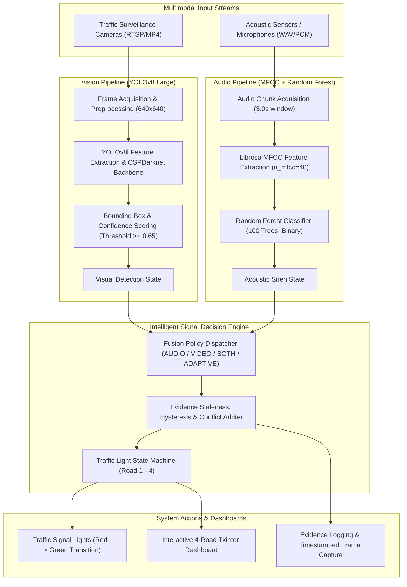
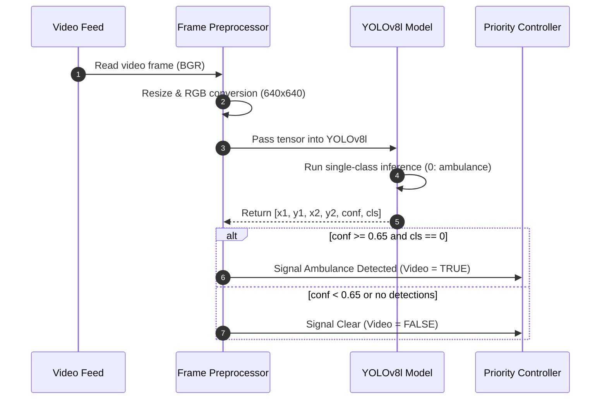
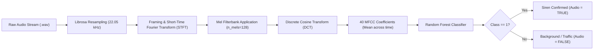
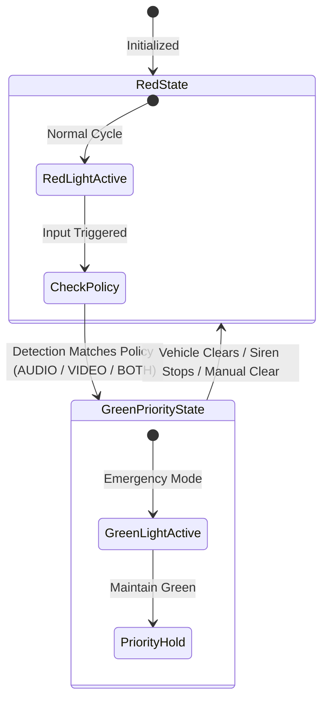

# System Architecture & Technical Workflows
## AI Ambulance Detection & Traffic Signal Priority System

---

## 1. System Architecture Overview

The system operates as a multimodal, dual-channel edge AI pipeline designed to decongest urban intersections during emergency vehicle transit.



---

## 2. YOLOv8 Ambulance Detection Workflow



---

## 3. Acoustic Siren Processing Workflow



---

## 4. Multi-Road Signal Priority Logic

The decision engine coordinates traffic states across an intersection with 4 approaches (**Road 1** through **Road 4**):



- **AUDIO Policy:** Requires positive siren acoustic classification.
- **VIDEO Policy:** Requires visual ambulance bounding box above threshold ($\ge 0.65$).
- **BOTH Policy:** Requires fresh evidence from both modalities within the configured staleness window, reducing false alarms.
- **ADAPTIVE Policy:** `BOTH` plus a tighter temporal window; it is never looser than `BOTH`.

> **Implemented behaviour note (Stage 8):** `new.py` is now a thin launcher for `ambulance_system.dashboard.app`. The dashboard's headless view-model owns a `FusionEngine` and the Stage 3 `SignalController`; audio and video evidence expires after `fusion.stale_after_s`, the controller applies activation/release hysteresis and transition timing, and only one approach can hold GREEN. Detection flags are no longer latched: priority is released when evidence goes stale or the release rules are met. **Clear All** remains a manual full reset (sources, evidence, metrics, signals and policies), and **Simulate Fault** forces all-red until **Clear Fault**. See [`dashboard.md`](dashboard.md), [`fusion.md`](fusion.md) and [`signal_state_machine.md`](signal_state_machine.md).

## 5. Hardware Boundary (Stage 14)

The signal controller is separated from any physical output by `ambulance_system.hardware`:

```text
FusionEngine → SignalController → HardwareController (interface)
                                   ├── SimulationController  (default, in-memory)
                                   └── MockController        (tests only)
```

* The interface exposes `connect`, `disconnect`, `apply`, `apply_all_red` and `snapshot`.
* `SimulationController` records timestamped commands and never opens a device.
* Every controller starts disconnected and all-red; a colour is only accepted while connected.
* The hardware layer does not validate phase transitions; that stays in `traffic_signal`.
* It is **not** wired into the dashboard, and no GPIO, relay, serial or network device is imported.

A physical adapter is future work and must keep the same safe defaults plus an independent emergency shutdown. See [`hardware_integration.md`](hardware_integration.md).

## 6. Offline Direction Research (Stage 13, Experimental)

`ambulance_system.localisation` is a separate, offline branch:

```text
two synchronised channels → GCC-PHAT TDOA → far-field bearing
```

* `gcc_phat.py` estimates the delay between two channels with a phase-transform
  cross-correlation.
* `doa.py` converts pair delays into a bearing, or solves a 2-D bearing from two
  or more non-collinear pairs.
* `simulation.py` generates synthetic plane-wave and two-source signals with
  known delays for tests and the benchmark.

The branch is **not imported by fusion, the signal controller or the dashboard**.
It does not identify sirens, does not assign an approach and does not produce a
geographic position. Its only published results are synthetic free-field method
checks. See [`localisation.md`](localisation.md).

